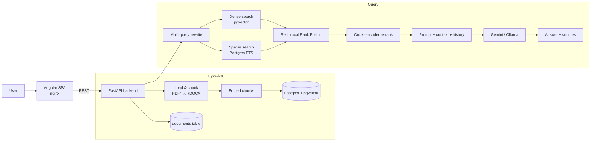

# 🧠 DocuMind — Full-Stack RAG Platform

**🔗 Live demo: [documindchat.netlify.app](https://documindchat.netlify.app)**

A production-style **Retrieval-Augmented Generation** platform: upload documents, then ask
questions answered **only from their content**, with cited sources, hybrid retrieval,
re-ranking, conversational memory, evaluation metrics, and full observability.

Built as a monorepo with an **Angular** frontend and a **FastAPI** backend, backed by
**Postgres + pgvector**, and fully containerized with CI.

> **Stack:** Angular 22 · FastAPI · Postgres/pgvector · LangChain · HuggingFace embeddings ·
> Google Gemini · Docker · GitHub Actions

---

## ✨ Features

- 📄 **Multi-format ingestion** — PDF, TXT, DOCX
- 🧠 **Free local embeddings** (`all-MiniLM-L6-v2`) or a lightweight embedding **API** — switchable
- 🔎 **Hybrid retrieval** — dense (pgvector) + sparse (Postgres full-text), fused with **Reciprocal Rank Fusion**
- 🎯 **Cross-encoder re-ranking** for precision
- ♻️ **Multi-query rewriting** to improve recall
- 💬 **Conversational memory** — follow-up questions resolve against chat history
- 🔗 **Grounded answers with sources** — every reply cites the chunks it used
- 🗂️ **Document management** — list, inspect, and delete documents (vectors + metadata)
- 📊 **Evaluation harness** — RAGAS-style metrics (faithfulness, answer relevancy, context precision/recall)
- 🔭 **Observability** — structured JSON logs + per-request latency, token usage, and estimated cost
- 🔄 **Swappable LLM** — Google Gemini (default) or local Ollama, via env var
- 🐳 **Dockerized** with `docker-compose` and **GitHub Actions CI**

---

## 🏗️ Architecture



| Layer | Technology |
| ----- | ---------- |
| Frontend | Angular 22 (standalone, signals), nginx |
| Backend | FastAPI, Pydantic, Uvicorn |
| Vector DB + metadata | Postgres + pgvector (Neon free tier) |
| Embeddings | HuggingFace `all-MiniLM-L6-v2` (local) or Gemini embedding API |
| Retrieval | Hybrid (dense + BM25-style FTS) + RRF + cross-encoder re-ranking |
| LLM | Google Gemini `gemini-flash-lite-latest` (REST) · optional Ollama |
| Infra | Docker, docker-compose, GitHub Actions |

---

## 📁 Monorepo structure

```
.
├── backend/                     # FastAPI service
│   ├── app/
│   │   ├── main.py              # app, CORS, observability middleware, lifespan
│   │   ├── config.py           # env-driven settings (provider switches)
│   │   ├── api/                # chat (JSON + SSE), documents (ingest/list/delete)
│   │   ├── core/               # loader, chunker, embeddings, vectorstore, retriever, reranker, query_rewrite, llm
│   │   ├── db/                 # SQLAlchemy engine/session + Document model
│   │   ├── schemas/            # Pydantic request/response models
│   │   ├── services/           # ingest + chat orchestration
│   │   └── observability/      # structured logging + per-request metrics
│   ├── evaluation/             # RAGAS-style metrics + golden dataset + runner
│   ├── tests/                  # pytest (unit + integration)
│   ├── Dockerfile
│   └── requirements.txt
├── frontend/                    # Angular app (chat UI, upload, doc manager)
│   ├── src/app/                # components, services, models
│   ├── Dockerfile              # multi-stage build -> nginx
│   └── nginx.conf              # serves SPA + proxies /api to backend
├── docker-compose.yml
└── .github/workflows/ci.yml     # backend tests + frontend build
```

---

## �️ Run it locally (from a fresh clone)

> **You bring your own credentials.** This repo ships **no** keys or database — `backend/.env`
> is gitignored. You run DocuMind with **your own** LLM (a free Gemini key *or* local Ollama)
> and **your own** database (the bundled local Postgres, *or* a free Neon URL). Start by copying
> `backend/.env.example` → `backend/.env` and filling in the blanks.

### Prerequisites
- **Git**
- **Easiest path:** Docker Desktop
- **Manual path:** Python 3.11+ and Node.js 20+
- An **LLM**: a free [Gemini API key](https://aistudio.google.com/app/apikey) *or* [Ollama](https://ollama.com) (offline, no key)

### What you must provide
| Need | Options |
| ---- | ------- |
| **LLM** | Gemini key (`GOOGLE_API_KEY`) **or** Ollama (`LLM_BACKEND=ollama`, no key) |
| **Database** | Bundled local Postgres (Docker) **or** a free [Neon](https://neon.tech) `DATABASE_URL` |
| **Embeddings** | Nothing — a free local model downloads automatically (default) |

### 1. Clone
```bash
git clone https://github.com/arunava3798/DocuMind.git
cd DocuMind
```

### Option A — Docker (easiest: whole stack incl. database)
Spins up the frontend, backend, **and a local Postgres + pgvector database** — no cloud DB needed.
```bash
cp backend/.env.example backend/.env     # then set GOOGLE_API_KEY (or LLM_BACKEND=ollama)
docker compose up --build
```
- App → http://localhost:4200
- API docs → http://localhost:8000/docs

The compose file provisions the database and points the backend at it automatically, so the only
thing you must supply is an **LLM**. (To use Neon instead of the bundled DB, comment out the
`DATABASE_URL` override in `docker-compose.yml`.)

### Option B — Manual (run backend & frontend yourself)

**1. Database** — either run just the bundled DB with `docker compose up db`, or create a free
[Neon](https://neon.tech) project and copy its connection string.

**2. Backend** (terminal 1):
```bash
cd backend
python -m venv .venv
.venv\Scripts\Activate.ps1          # Windows
# source .venv/bin/activate         # macOS/Linux
pip install -r requirements.txt
copy .env.example .env              # cp on macOS/Linux — then set GOOGLE_API_KEY and DATABASE_URL
uvicorn app.main:app --reload --port 8000
```

**3. Frontend** (terminal 2):
```bash
cd frontend
npm install
npm start
```

**4.** Open **http://localhost:4200**, upload a PDF / Word / Excel / PowerPoint / TXT file, and ask
away. (First question downloads the small embedding model, ~90 MB — one time.)

> 💡 Prefer **no API keys at all**? See [Run fully offline (Ollama)](#-run-fully-offline-ollama) below.

---

## ⚙️ Configuration (`backend/.env`)

Everything is env-driven, so the same code runs locally, in Docker, and in the cloud.

| Variable | Purpose | Default |
| -------- | ------- | ------- |
| `GOOGLE_API_KEY` | Gemini API key ([free](https://aistudio.google.com/app/apikey)) | — |
| `DATABASE_URL` | Postgres/pgvector URL ([Neon free](https://neon.tech)) | — |
| `LLM_BACKEND` | `gemini` or `ollama` | `gemini` |
| `EMBEDDING_BACKEND` | `local` (sentence-transformers) or `api` (Gemini) | `local` |
| `RETRIEVAL_MODE` | `hybrid` or `dense` | `hybrid` |
| `RERANK_ENABLED` | cross-encoder re-ranking | `true` |
| `MULTI_QUERY_ENABLED` | multi-query rewriting | `true` |
| `TOP_K` | chunks passed to the LLM | `4` |

---

## 📊 Evaluation

A small golden dataset + a RAGAS-style metrics harness lets you measure retrieval and answer quality.

```bash
cd backend
python -m evaluation.evaluate
```

Sample run (6 questions):

| Metric | Avg |
| ------ | --- |
| context_recall | 1.000 |
| context_precision | 0.583 |
| faithfulness | 1.000 |
| answer_relevancy | 0.842 |
| answer_correctness | 0.958 |

---

## 🧪 Testing

```bash
cd backend
pytest
```

- **Unit tests** (offline): chunking, Reciprocal Rank Fusion
- **Integration tests**: ingest → chat → delete (auto-skipped if `DATABASE_URL`/`GOOGLE_API_KEY` are unset)

CI runs the backend tests + lint and the frontend build on every push via GitHub Actions.

---

## 🔭 Observability

Every request emits a structured JSON log and response headers:

```json
{"level":"INFO","message":"request","path":"/api/chat","status":200,
 "total_ms":1850.4,"llm_calls":2,"total_tokens":772,"est_cost_usd":0.000085,
 "timings_ms":{"retrieval_ms":900.1,"llm_ms":950.3}}
```

Headers: `X-Process-Time-Ms`, `X-LLM-Total-Tokens`, `X-Est-Cost-USD` (shown live in the UI per message).

---

## ☁️ Deployment (free tier)

- **Frontend** → Vercel / Netlify / Cloudflare Pages (static Angular build)
- **Backend** → Hugging Face Spaces (Docker) or Render — the backend `Dockerfile` honors `PORT`
- **Database** → Neon / Supabase (free managed Postgres with pgvector)
- **LLM** → Gemini free tier (no compute needed)

For hosted deployments set `apiBase` in `frontend/src/environments/environment.production.ts`
to the backend URL, or serve the frontend behind nginx which proxies `/api` to the backend.

---

## 🔄 Run fully offline (Ollama)

```bash
ollama pull llama3.2
```

Set `LLM_BACKEND=ollama` (and optionally `EMBEDDING_BACKEND=local`) in `backend/.env`. No API key needed.

---

## 🧠 What this project demonstrates

- End-to-end **RAG system design**: ingest → chunk → embed → hybrid retrieve → re-rank → generate
- **Information retrieval** depth: dense + sparse fusion (RRF), cross-encoder re-ranking, multi-query
- **Backend engineering**: typed FastAPI, service layer, SQLAlchemy + pgvector, SSE streaming
- **Frontend engineering**: Angular standalone components, signals, typed HTTP service
- **Quality engineering**: RAGAS-style evaluation + pytest (unit & integration)
- **Production concerns**: structured logging, cost/latency observability, provider abstraction
- **DevOps**: Docker, docker-compose, GitHub Actions CI, free-tier cloud deployment

---

## 📜 License

MIT — free to use and adapt.
